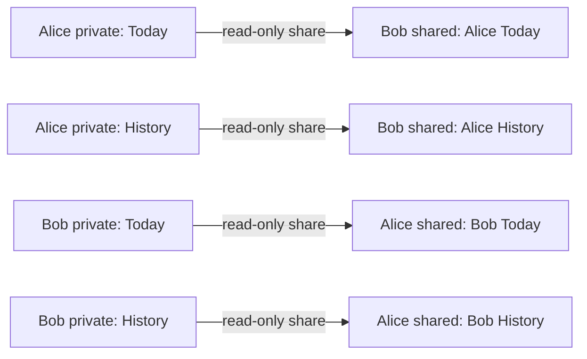

# Calorie card sharing specification

Agreed product specification, 2026-10-23. Count.kcal will let two people share the same calorie-card values they see themselves. Sharing is mutual, private, and separately configurable for today and the previous six completed days. The dashboard keeps its existing toolbar and gains a Sharing button below the Progress card.

The product decisions are settled. The date window governs app display and caching, with eventual cloud cleanup. Account changes stop publication and clear account-specific received data from the device. The CloudKit architecture below is the preferred design, subject to Apple's clarification about this payload and a two-account technical experiment. The implementation is on `codex/calorie-card-sharing`, with local verification and remaining release checks recorded in [the verification report](calorie-card-sharing-verification.md).

## Scope

Both people use Count.kcal on iPhone. The preferred implementation requires an available iCloud account and uses CloudKit for persistence and retrieval. It keeps the existing SQLiteData library, currently version 1.12.0. There is no browser client, public user directory, or separate Count.kcal account system in this design.

A person can have multiple independent connections. Each connection has its own consent and data access. Recipients cannot discover one another through a shared group. One designated iPhone per Apple Account publishes that person's cards. A replacement phone can take over explicitly. Simultaneous publishers and sharing on iPad, Watch, widgets, or the web are outside this version.

Highlights, messaging, rankings, and competitions are also outside this version. Invitations and requests can use Messages or Mail through Apple's sharing interface. The app never sends a message without the person's action.

## Terms and sharing choices

A connection is the mutual relationship between two identified accounts. A scope is permission to exchange Today, History, or Goal status & streak. History means the sender's previous six completed calendar days. Streak is the sender's full consecutive completed-goal-day count, ending yesterday. A snapshot is the last successfully published sender presentation, including its capture time. A consent generation identifies a particular mutually accepted grant and separates it from older requests or revoked grants.

| Today | History | Shared content |
| --- | --- | --- |
| Off | Off | No calorie cards available. A separately accepted full streak may remain shared. |
| On | Off | The sender's current local day, with Now and Midnight values. |
| Off | On | The sender's previous six completed days. |
| On | On | Today and the previous six completed days. |

Goal status & streak requires explicit mutual acceptance. It includes daily reached/not-reached results and excluded-day choices only for the calorie dates already permitted by Today or History, together with the full streak count ending yesterday. The count may extend beyond six days and can be shared without calorie dates. Numeric goal targets are never shared. Its count expires at sender midnight. The viewer’s Hide goal status icons preference controls rendering only.

Remove the development-only Streak permission and its upgrade UI. Retire existing count-only grants through normal revocation, preserving the connection and its calorie permissions. The sole Goal status & streak switch is off until a fresh request is accepted. See ADR 0005.

The accepted scope is symmetric. Alice and Bob cannot select different disclosure scopes within the same connection. Their actual available data may differ because publication is asynchronous or one phone has no new reading.

Either person can reduce the scope. Expansion requires explicit acceptance by the other person. A change that both removes and adds permissions applies the removal first and treats the addition as a separate request. Turning all three scopes off pauses the connection. Resuming any scope needs acceptance. Removing a connection ends it for both people; reconnecting requires a fresh invitation.

Every expansion request names its exact proposed scope and the consent state it extends. Any reduction invalidates outstanding expansion requests. A delayed acceptance, restored backup, or offline write must never restore revoked permission.

## Screens and visual behavior

The navigation follows Apple's compact overview followed by a person's detail screen. Apple's broader Fitness data scope and social features are not part of this adaptation. See the [interface research](research/calorie-card-sharing-cloudkit.md#fitness-interface-reference).

### Dashboard

Keep the toolbar unchanged. Place a Sharing button below the Progress card. It opens a dedicated Sharing screen in the existing navigation structure.

### Sharing overview

Every calorie summary row keeps the same ring footprint, body-size status line, and minimum height when values are unavailable. Center the actual text block vertically beside the ring: two lines without a timestamp, three when a timestamp is available. Do not reserve an invisible caption. Connections sharing goal information without calorie dates say "No calorie cards shared". This includes paused sharing, goal sharing without calorie dates, empty history, connection setup, and a loading or unavailable Me card. Use the same neutral rings at 65% opacity; never invent calorie values or timestamps. Known name colors remain visible, including across pauses and relaunches. Retain only the name color for a paused person, clear it on removal or account changes, and continue removing their calorie snapshots and update metadata. At accessibility text sizes, omit the rings consistently for all states to give the text room.

When Today is enabled but its update is missing, retain the normal row geometry, inset divider, and tappable navigation. Show neutral empty calorie arcs at 65% opacity so they remain visible against the row background, the sender's last known name color, and body-size secondary text reading "No update yet today". The last line is a red caption showing "Last shared" with the last trusted capture time when known; otherwise center the two-line text block within the same row height. Red applies whenever today's update is missing, including immediately after sender midnight. Retain only sender metadata after calorie snapshots expire. Never show a spinner in a person row, including during refresh, and update the row in place when data arrives. Show a streak badge only when its independently permitted current summary is available.

Show compact person cards sorted alphabetically, with an initials avatar, display name, the existing open calorie arcs, and the last update time. Use three text rows for an available card: the name in the sender's goal accent with semibold body type, a regular-weight body-size balance and label on one line, and a secondary caption reading Updated with the snapshot's relative capture time. Outgoing request status belongs only in sharing settings. Cards without a snapshot show their status without inventing an update time. Keep the three rows compact with 1-point interrow spacing and 14-point top and bottom row insets; retain caption-size update text for readability. Preserve the original graph proportions with a 49-point visible arc height scaled with body text, independent of the timestamp or wrapped names. Center the visible arcs optically by accounting for the bottom opening. Use the sender's Now snapshot when Today is enabled. A history-only connection shows the most recent available permitted day with its localized sender date. A paused, pending, or unavailable connection shows its state instead of an unexplained zero or old value.

Names use the sender's burned-energy color for a loss goal and consumed-energy color for a gain goal, matching the goal accent used by their flame. Publish only the resolved name color as optional appearance metadata, independent of goal-result or streak permission; older snapshots fall back to burned-energy color. Preserve this name color when Today is missing or sharing is paused. In the balance line, keep the value and energy unit in primary text color and use secondary text color for the localized balance, deficit, or surplus description. Preserve the full localized phrase so each language controls its word order.

When the viewer has not enabled "Hide goal status icons", show a checkmark or xmark inside each overview ring, including Me, using that person's visible goal result for the displayed Now or Midnight values. Use a 10-point semibold symbol scaled with body text, centered horizontally and offset 2 points below the circle's center. Never calculate another person's goal result from the viewer's goals. Omit the symbol for hidden goal results, empty values, and missing or unsupported snapshots. VoiceOver announces the same goal result, including at accessibility text sizes where rings are omitted. This viewer preference hides symbols in both overview and detail. A received goal result additionally requires the separate goal grant and the matching calorie date grant. It never changes published goal information.

Use the same smooth half-second row animation for Now/Midnight switches, refreshed calorie or goal values, streak changes, and a missing Today update becoming available. Animate changed values in place without replacing the row's identity. Unchanged refreshes do not restart the animation. Respect Reduce Motion for all of these updates.

Show a Me section above People, with the saved name, local calorie arcs, and balance in the same row style as shared people. Incoming requests appear in a third Invitations section after People, only when needed. For an established connection, the invitation name uses the same sender goal color as its People row, including the cached name color when no calorie snapshot is available. A new invitation without a known color uses primary text. Rows show the person and requested change and open the existing review sheet. Me opens a normal detail screen with the full local calorie card, a name-editing row, notification status and settings, and How sharing works. Only the focused name editor has Save and Cancel. Show update-device recovery only when another iPhone requires explicit replacement. The overview has no profile toolbar button; Invite stays below People. One shared Now/Midnight toolbar button uses the dashboard control and switches both Me and People together. Section headers have no separate mode buttons. History-only rows keep their recorded totals. The empty state explains mutual sharing and offers an enabled Invite action. Successful acceptance and decline keep the reviewed content visible while submitting, then dismiss without an unavailable-request screen. Never-accepted cancelled, declined, or expired invitations do not become paused People entries. Missing-name setup appears in that flow; it must not disable request review or decline. Saved and sent initial outgoing invitations are managed inside Invite, including Continue invitation and Cancel invitation. Outgoing additions and resumption appear only in the person’s sharing settings, with no overview dots, detail badges, or menu status subtitles. Notification denial must not hide requests from this screen.

With Goal status & streak consent, the overview adds a separate vertically centered column beside the chevron, ordered count then flame so numbers and flames align across rows. It does not increase the spacing between the name and calorie lines. The flame has the dashboard's size and motion; all positive overview flames share one animation clock, while zero counts stay still. Detail places the flame and count beside Settings in the original flame-then-count order. Missing or unpermitted streaks have no badge, and Reduce Motion disables flame motion.

Use the app's existing card shapes, spacing, and typography. Allow larger text to expand rows. Status and permission must be understandable without color. A summary must not expose a hidden goal-status indicator or an unauthorized date.

### Person detail

Show all permitted sender-local daily cards in descending date order, newest first, with a date heading and capture-time caption for each card. There are at most eight cards. Use a scrolling feed without a date picker or duplicate body settings button. Today uses the dashboard's recessed calorie-card button to switch Now and Midnight, with the current mode beside the date heading and a vertical fallback for larger text. Do not use a segmented mode picker. Bob's selection does not change Alice's selection or republish her data. Historical cards are noninteractive recorded totals, with no Midnight projection or mode switch.

The Today and Previous 6 Days switches come first in sharing settings, followed by Goal status & streak. Their section footer shows the sharing duration in place of a separate history explanation. Save or send uses the sheet’s confirmation toolbar action, and How sharing works is an unboxed link. The leading toolbar action cancels the unsaved draft, using the native X on iOS 26 and later and a text Cancel button on earlier versions. The trailing action stays disabled until the draft changes; these actions retain separate cancel and commit semantics. Changes between the checkmark and send symbols use the native replacement transition, respecting Reduce Motion. The sheet fits its measured content height, growing for errors, translated text, or larger text sizes. A short footer describes goal results and the private numeric target. With no calorie dates selected, it explains that only the full streak is shared. There are no legacy controls or upgrade prompts. Content remains scrollable when it exceeds the available screen height.

Sharing settings show how many local calendar days the current uninterrupted sharing period has lasted, starting at accepted calorie consent. Today-only to seven-day sharing and the reverse retain the same start. A full pause ends the period; accepting a request to resume begins a new one. Existing connections recover their start by replaying owner-attested consent events.

Sharing settings expose three draft permissions: Today, Previous 6 Days, and Goal status & streak. The draft switches start with an outgoing proposal’s scopes when one exists, otherwise the accepted scopes. Unaccepted proposed options are marked Requested. Editing a pending proposal uses Update request and preserves its other options. Cancel request restores the accepted selection. Keep a paused-state note when relevant; do not repeat the active scopes in a separate summary. Turning all sharing switches off requires explicit pause confirmation before applying the draft. The primary action describes the consequence: Save changes, Send request, Save and send request, Pause sharing, or Request to resume. An unchanged draft cannot be submitted. Drafts validate both accepted scopes and proposal identity before saving. Remote changes update untouched drafts; edited drafts offer Use current settings instead of requiring a manual refresh. Every changed draft opens a native confirmation dialog from the enabled toolbar action. Request dialogs name the recipient, requested scopes, and what stays shared or stops. Reduction dialogs identify the removed and retained scopes and explain that restoring removed days requires the peer’s approval. A full pause explains that resuming requires approval. Mixed changes describe both the immediate reduction and the requested addition. The confirm action uses system default-action prominence. Nothing is committed before confirmation; Cancel retains the unsent draft. No selection-dependent inline explanation duplicates the dialog. Reductions take effect locally immediately and show their pending server state above affected cards. Expansions stay visibly requested until accepted and provisioned. A menu using the dashboard's filled gear icon provides the one-word actions Settings, Pause, and Remove. The confirmation dialogs retain their explanatory wording. Removal returns to Sharing, where unconfirmed cloud access removal remains actionable. Failed actions retain their drafts unless the reduction was already durably committed locally.

Never show yesterday's card as today's. When Today is enabled and its update is missing, make the navigation subtitle's last-shared timestamp red, matching the overview caption. Omit the duplicate missing-update row above historical cards. VoiceOver also announces "No update yet today" for the subtitle. Keep the empty-state explanation when no cards are available. History-only sharing retains a secondary subtitle. If History is enabled, yesterday remains available under its actual date.

### Visual identity and accessibility

The shared card uses the sender's resolved values, energy unit, selected card colors, and separately permitted goal results. The viewer’s Hide goal status icons preference applies to checkmarks and crosses. It must not read the recipient's goals, energy settings, or color preferences. Device layout, Dynamic Type, VoiceOver, and reduced-motion behavior adapt to the recipient's device. Use a native card, not an image.

Any remaining rendering choices, such as contrast against the recipient's screen background, must preserve the sender's semantic colors and numbers. Verify visual parity against the local card across both modes and accessibility sizes before release.

## Invitation and consent flow

Collect an app display name during the first invitation or before accepting a request. Later edits use the focused name editor opened from Me. Use an initials avatar and require no Contacts access. The display name is not verified identity. Bind invitations and consent to the intended CloudKit account, never to a user-editable name.

Save a valid name locally and close the editor immediately. Retain the latest pending profile value across relaunch and retry it on ordinary refresh or reconnect. Serialize profile writes so an older completion cannot discard a newer name.

iCloud work must not prevent Close or swipe dismissal. Guard duplicate invitation operations and publisher changes without disabling unrelated sharing controls. Closing an invitation discards any late preparation or resume result. Pause, Remove and initial-request cancellation complete after their existing durable local mutation is saved; cloud work continues independently. Native invitation creation, recovery, cancellation and publisher selection still require their cloud response before reporting success.

During an authorized invitation or acceptance, automatically select this iPhone only if a server-verified publisher record is unclaimed or already belongs to this device. The CloudKit write must reject a concurrent claim. An existing publisher on another iPhone requires explicit Use this iPhone confirmation that explains the replacement. Opening Sharing alone must never claim or replace a publisher. Routine publication needs no status section in Me. Its update-device recovery control appears only when another iPhone requires explicit replacement. The local Me card does not claim that everyone receives the same day permissions or has received the latest update.

New invitations propose Today only by default. Today, Previous 6 Days, and Goal status & streak are independently selectable; at least one must be on. Goal status & streak without calorie dates shares only the count. Show a concise disclosure of card content, reciprocity, access removal and retention limits, with How sharing works available. Explain beside History that it includes the six completed sender days, including dates before connection. Send invitation opens Apple’s native delivery sheet directly. The share is created only when the system prepares delivery. The app has no recipient email or name form. Apple handles recipient selection and delivery. Incoming additions explain what changes and which scopes survive decline. Do not include calorie values in invitation previews or setup records.

Create an empty private metadata share and retain the original scopes, expiry, proposal and mutation identifiers in the inviter’s encrypted private directory. The system sheet permits specified recipients only. Require exactly one private recipient with the setup permissions, bind its participant identifier from the owner’s saved share, and cancel multi-recipient invitations before any calorie proposal is created. Obtain the account identity only after CloudKit accepts that participant. The writable setup record cannot bind an account or authorize a calorie scope. The recipient may see a waiting state until the inviter finishes this step. Opening metadata still shares no calories; explicit in-app consent and reciprocal readiness remain required. Pending invitations can reopen the native sheet. Existing email-bound drafts remain readable. See ADR 0002.

The recipient explicitly accepts mutual sharing. The desired experience is one visible invitation, with the reciprocal CloudKit setup handled by the app. Keep the connection pending until both directions are ready under the same accepted scope. Programmatic acceptance must validate the account, container, connection, scope, and consent generation.

Invitations and expansion requests expire after seven days. Their sender can cancel, and their recipient can decline without giving a reason. There are no automatic reminders. An unanswered expansion does not interrupt existing sharing. Expiry of a request is an application-consent rule and must not be described as automatic CloudKit record expiry.

A cancelled or declined initial request permits a fresh invitation to the same person. Established relationships, including paused sharing, use their existing connection. Reopening an accepted invitation opens that person's sharing detail; unavailable requests show a completed unavailable state. Setup progress appears only while setup is still pending.

| State | What the person sees | Data behavior |
| --- | --- | --- |
| Invitation pending | Proposed scope and accept, decline, or cancel actions as appropriate | No calorie disclosure. |
| Connecting | Accepted scope and setup progress or retry | No premature disclosure from a partially established connection. |
| Active | Agreed scope and latest available snapshots | Publish and display only accepted scopes. |
| Expansion requested | Existing scope plus the requested addition | Continue the existing scope only. |
| Reduction pending | Reduced scope and pending server confirmation | Stop affected local publication and viewing immediately; retry unconfirmed revocations. |
| Paused | No active scopes; option to request resumption | No card display or publication for the pair. |
| Removed | Connection closed | Revoke access, remove local received cards, and reject stale setup work. |

These are protocol states, not necessarily separate full-screen views. Errors should preserve the relevant state and offer an understandable retry.

## Card contents and publication

Capture the presentation values after a successful relevant refresh. Today's Now and Midnight values must belong to one consistent snapshot version. Do not combine fields from different refreshes after synchronization conflicts.

The proposed payload contains only what the card needs:

- Connection, scope, consent generation, publisher generation, snapshot version, and schema version.
- Sender-local date, the time zone used for calculation, day bounds, and capture time.
- Resolved energy components and totals for each permitted mode, including any projected component.
- Energy unit and deficit or surplus presentation.
- Goal results and exclusions only in the separate goal scope, tied to the corresponding calorie consent generation.
- Portable color values and the display options needed to reproduce the card.

Do not upload raw HealthKit samples, source identifiers, meal details, weight, macros, steps, the full Settings object, or the resting-energy history used to calculate a projection. Never transmit numeric goal thresholds. Exact field types and encoding belong to the technical experiment, but these disclosure limits are binding.

Calorie payloads and legacy received calorie caches strip embedded goal results, exclusions and streaks. Each daily goal result references the calorie scope and consent generation that authorized its date. Receiving and cleanup reject results from revoked or replaced date grants. Display joins goals only to the same snapshot identity and capture time; an unmatched goal update must never label a newer calorie value.

The snapshot builder uses the same calculation and presentation logic as the local calorie card. It must not temporarily change global Settings to render another person's card. The recipient renders stored values and never recalculates the sender's energy using the recipient's preferences or current clock.

Publish automatically after successful relevant data refreshes and appearance changes. Use background opportunities when iOS permits them. A recipient's refresh fetches the latest server snapshot; it cannot force the sender's HealthKit store to refresh. No continuous live-update guarantee is made.

Failed reads preserve the previous successful snapshot and its original update time. They must not publish fabricated zeroes. A valid zero remains a valid zero. HealthKit can make denied reads appear empty, so the app must not claim that it can reliably diagnose another person's permission settings from missing data. Before any successful snapshot, show an unavailable or waiting state.

Late HealthKit samples or corrections republish affected historical cards. Existing recipients may see a correction to an already viewed date. The app does not accumulate earlier snapshot versions as a recipient archive.

## Dates and offline behavior

Use the sender's calendar days, including daylight-saving changes. The permitted history is six completed dates, not a duration of 144 hours. Use captured time-zone information to interpret a snapshot; the recipient's calendar must not regroup it.

After the sender travels, a successful refresh recalculates and republishes the affected permitted dates according to the sender's current time zone. Show the sender's date and identify the time zone when it differs from the recipient's. Do not regroup previously captured values on the recipient before corrected snapshots arrive.

Offline recipients can view cached cards within the permitted app date window, with their update times visible. The app removes expired cards and cards affected by a learned reduction or disconnection. A sender's unknown subsequent travel cannot be inferred by an offline recipient; use the last received sender time zone until a newer snapshot arrives.

Offline reductions stop the initiating device's affected publication and display immediately. Preserve the revocation work durably and show it as pending until the server operations succeed. Do not say the other person's server access has ended before confirmation. Even confirmed revocation cannot erase information already seen, screenshots, or an offline copy before that device learns the change.

## Preferred persistence and architecture

Keep SQLiteData for the local sharing store and its CloudKit synchronization support. Isolate sharing tables and account lifecycle from the existing local day choices. Enabling sharing must not silently synchronize the HealthKit store or unrelated app settings.

Use CloudKit private records for outgoing data and the shared database for received data. Each direction belongs to its sender. Recipients receive read-only access. Use private, account-addressed shares with no public link access. Apple's standard CloudKit protection is accepted; universal end-to-end encryption and mandatory Advanced Data Protection are not requirements. Describe the actual protection accurately.

Use a separate hierarchy for each connection, direction, and independently revocable scope. With both calorie scopes enabled, a pair has up to four calorie shares. Goal status & streak adds its own hierarchy per direction. Obsolete development Streak hierarchies are revoked, never reused for goal consent. A small metadata-only setup share may also be needed to exchange reciprocal references. No calorie payload belongs in writable setup records.

When Alice turns off History, her phone deletes her outgoing History share and leaves Bob's incoming History share. Both operations can reach CloudKit without Bob's app running. Today remains available. Record each successful deletion and retry the other after partial failure. CloudKit does not provide one atomic transaction across both owners' databases. See the [revocation research and API sources](research/calorie-card-sharing-cloudkit.md#independent-reductions-while-the-other-phone-is-offline).

Deleting a share does not necessarily delete its owner's underlying records. Remove pair-specific orphaned payloads when the owner can process cleanup. Leaving a read-only share must use the CloudKit share-deletion operation, not a SQL delete of the received calorie row.

Keep the implementation responsibilities separate:

| Responsibility | Contract |
| --- | --- |
| Snapshot builder | Produce an immutable, minimal card from successful local calculations and presentation settings. |
| Sharing coordinator | Own consent transitions, pending work, account identity, publisher takeover, and permitted publication. |
| Sharing store | Persist snapshots, account-scoped connection state, operation progress, and received-cache expiry. |
| CloudKit adapter | Create and accept shares, verify server identity, revoke each direction, and reconcile errors with SQLiteData. |
| Card presentation | Render an explicit snapshot without consulting the recipient's calorie preferences. |

The coordinator must not treat last-writer-wins Boolean synchronization as proof of consent. Use explicit proposals, acceptance bound to a generation, and reductions that invalidate older work. Authoritative consent must be owner-controlled and verified against CloudKit identity. A writable setup record claiming that Bob accepted is insufficient.

Publisher takeover creates a new publishing generation. Every publication and retry must obey the current generation, and recipients must reject obsolete publications. Proving that a restored or offline old phone cannot resume publishing is part of the technical experiment, not a guarantee supplied by SQLiteData itself.

## Notifications

Offer optional notifications for invitations and expansion requests. Never include calorie numbers. Keep calorie updates quiet, and show other connection changes within Sharing. Request notification permission in context. Delivery is best effort; the Sharing screen is the authoritative place to find requests.

## Retention and account lifecycle

### Expiry on the server

CloudKit has no documented scheduled share or record expiration suitable for this design. Count.kcal can enforce the app display/cache window and remove old cloud records when a capable device next runs. If no device performs cleanup, an expired record can remain cloud-accessible. This affects a Today-only card after midnight as well as the oldest historical day. A date filter or expiry field does not remove CloudKit read permission.

The agreed rolling window is an app display/cache guarantee, with cloud cleanup whenever the publishing phone can run. It is not an exact time-based server-access deadline. Explain the distinction in the sharing disclosure, including that an expired cloud copy can remain retrievable until cleanup. Keep explicit permission reductions as server-confirmed revocations. Retry failed cleanup on subsequent opportunities and do not accumulate a deliberate cloud archive.

### iCloud account changes

After a confirmed sign-out or switch, stop publication and remove locally received cards and connection credentials for that account. Never transfer connections or consent to a different Apple Account. Keep ordinary Count.kcal health data and settings independent. Returning to the same account may restore only server-verified connections and consent, with publication ownership revalidated.

A temporary network error or indeterminate account status is not proof of a sign-out. Preserve the permitted offline cache, pause unsafe operations, and retry account verification. Signing out must not be presented as revoking existing cloud shares; it may prevent the device from executing that revocation.

## Release conditions and external validation

Apple's published rules leave the exact classification of this named, HealthKit-derived calorie payload unresolved. CloudKit is technically capable of the sharing primitives, but that alone does not settle permission under App Review 5.1.3 and the developer agreement. Keep CloudKit as the preferred candidate and obtain an answer about this exact payload and sharing use. The [research report](research/calorie-card-sharing-cloudkit.md) includes the evidence and an unsent clarification draft.

Before release, validate the implemented candidate protocol with synthetic data and two ordinary iCloud accounts. The experiment must establish:

1. One visible mutual invitation, intended-account binding, and reciprocal programmatic acceptance without premature calorie disclosure.
2. Read-only recipient permissions and isolation between connections and scopes.
3. Reduction of either scope in both directions while the counterpart's phone is offline, including partial failure and retry.
4. SQLiteData reconciliation after leaving one hierarchy while retaining another hierarchy from the same owner.
5. Rejection of stale expansion acceptance, recreated shares, restored backups, and queued writes from revoked consent generations.
6. Publisher takeover without obsolete devices overwriting accepted data.
7. Correct account switching and local cache separation.
8. App date-window enforcement, eventual cloud cleanup, and cleanup retries, without assuming an automatic TTL.

Use a small direct CloudKit adapter where SQLiteData's public interface does not cover share lifecycle operations. If the library prevents the required behavior, replace only the affected sharing synchronization component before considering a different backend.

## Test strategy

Most development and automated verification must work without physical phones or signed-in Apple Accounts. Put time, account state, health measurements, and cloud operations behind injectable dependencies. Keep real CloudKit integration tests separate from the repeatable local suite.

| Layer | Environment | Accounts | What it establishes |
| --- | --- | --- | --- |
| Consent, dates, snapshots, and persistence | Automated Swift tests with a controlled clock, synthetic data, and isolated SQLite stores | None | Exact product rules, retries, crash recovery, and protection against stale consent or publisher generations. |
| Screens and local integration | iOS Simulator with a fake sharing service | None | Invitations, pending states, permission changes, date browsing, mirrored cards, errors, and accessibility. |
| Real CloudKit integration | Two simulator instances signed in as different people, or a simulator and an iPhone | Two ordinary Apple Accounts | Actual share acceptance, identity binding, permissions, cross-account fetching, revocation, and SQLiteData reconciliation against Apple's service. |
| Physical-device release checks | Prefer two iPhones signed in as different people | Two ordinary Apple Accounts | Actual invitation handoff, HealthKit background delivery, locked-device behavior, suspension, connectivity changes, and recovery. |

Use dedicated test accounts and synthetic calorie snapshots for cloud integration. The CloudKit development environment is a real Apple service, not a local emulator. App Store Connect sandbox accounts cannot substitute for normal iCloud identities. The simulator runtime and Mac must support the particular system behaviors under test; verify invitation handoff on physical devices even when the underlying share operations pass in simulators.

The repository already has `HealthDataSource`, `SampleHealthDataSource`, controlled-source tests, an in-memory SQLite option, and a simulator-only `SimulatorHealthSeeder`. Reuse these for reproducible input and real simulator HealthKit queries. The seeder writes synthetic samples into the simulator HealthKit store; the sample source bypasses HealthKit entirely. Neither proves physical-device HealthKit background behavior.

Model Alice and Bob as separate local stores with a controllable fake transport for automated protocol tests. Deliver messages late, twice, out of order, or after a simulated restart. Advance the clock across midnight and daylight-saving changes without waiting in real time. Do not let these fakes serve as evidence that CloudKit enforces permissions.

In the real cloud suite, verify a denied write from a read-only recipient and attempt a direct server fetch using a previously known record ID after revocation. Merely hiding the card or deleting a local cache does not prove revoked cloud access. Exercise partial revocation failure and verify that reconnecting cannot restore old permissions.

Real-account tests run as a separate integration suite, rather than depending on interactive iCloud sign-in in every CI run. Before release, perform a controlled production-environment smoke test with the deployed schema and TestFlight build. TestFlight uses CloudKit production, while ordinary development testing uses the development environment. Do not assume a successful development run proves the deployed production schema is complete.

The [testing research](research/calorie-card-sharing-cloudkit.md#testing-on-simulators-and-devices) records the platform evidence and hardware limits. The implementation has passed local protocol tests, builds and controlled synthetic simulator checks. The real two-account experiment, hardware checks and production smoke test have not run; the [verification report](calorie-card-sharing-verification.md) distinguishes these results.

## Acceptance checks

- Alice and Bob see identical published numbers, units, permitted goal results, and selected colors. Their local icon preference may hide ticks and crosses. Both today modes come from one snapshot version.
- The overview and detail respect Today-only, History-only, both, and paused states. Historical grants include pre-connection dates within the permitted window.
- A failed read or upload keeps the previous capture time and values. A successful zero remains distinguishable from a missing snapshot.
- Midnight never presents yesterday as today. Date tests cover differing time zones, travel, daylight-saving changes, and late historical corrections.
- Either person can reduce a scope, including offline initiation and server partial failure. An old request cannot undo the reduction.
- Expired, canceled, declined, and replaced invitations cannot publish or restore data. No calorie content appears before mutual setup completes.
- Reinstall, takeover, account switch, share deletion, and unknown snapshot versions produce a safe explicit state rather than mixing identities or guessing values.
- Dynamic Type, VoiceOver, reduced motion, contrast, and long names work on the overview, consent screen, card, and pending states.
- Notification previews contain no calorie numbers. Denying notification permission leaves all sharing controls usable.
- The implementation and user-facing copy match the accepted expiry guarantee. Tests must not substitute UI hiding for server revocation.

The person screen uses dashboard card headers and spacing, with one latest-capture timestamp beneath the navigation title. When both scopes are enabled, it shows a fixed seven-day balance chart ending today in the sender's calendar. The chart reuses the dashboard drawing and streak shine without day selection or paging. Missing days remain placeholders. Hidden goal results do not contribute to a visible streak; excluded days break it. The sender's label background accompanies calorie snapshots. Excluded-day choices arrive only with separately permitted goal results; older snapshots remain readable.
